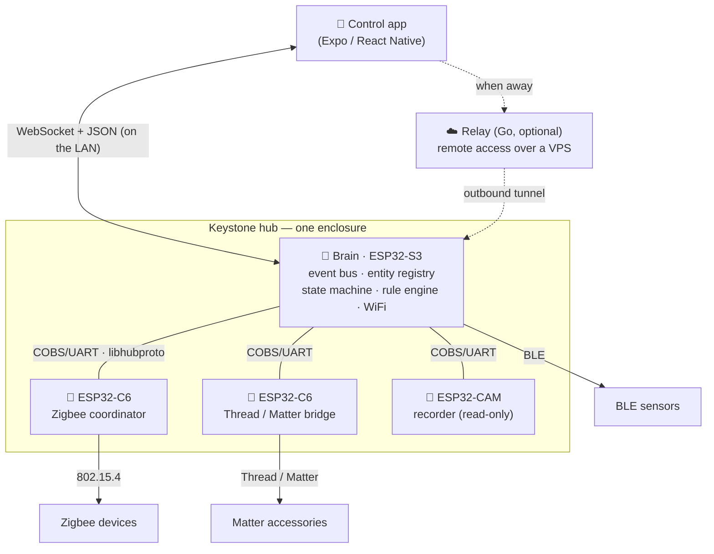

# Keystone

**A local-first smart-home hub that reimplements the core of Home Assistant on bare ESP32 — in C++ on ESP-IDF, across several chips in one enclosure.**

<div align="center">

[](https://github.com/kliuchnikovv/keystone/actions/workflows/ci.yml)
[](firmware/)
[](app/)
[](relay/)
[](LICENSE)

</div>

---

## What it is

Keystone is a smart-home hub that runs entirely on hardware you own. It reimplements the *core* of Home Assistant — an **event bus**, an **entity registry with a state machine**, and a **rule engine** — but deliberately **not** HA's integration zoo, history database, template engine, or web UI. The hub serves no UI of its own; a companion phone/web app talks to it over a small authenticated WebSocket + JSON protocol.

It is a **centralized hub, not a mesh**: all the "brain" chips live wired together in one box, and only the *end devices* (Zigbee lamps, BLE sensors, Matter accessories, DIY nodes) are distributed over radio. That is a deliberate trade — one box is a single point of failure, in exchange for a far simpler system: no distributed consensus, no lossy-radio sync protocol, and all rules running in one place.

**Why it is interesting:** the hard part is not any one feature — it is keeping the core portable. The registry, state machine, and rule engine have **zero radio-stack dependencies**, talk to transports only through a `Bus` interface, and model every entity in Matter-cluster shape from day one. That is what lets the brain migrate ESP32-S3 → ESP32-P4 → a Linux SBC later, with the radio chips simply becoming co-processors of the new brain.

## Architecture

One **brain** chip runs the core. Every other chip is a **radio co-processor** that owns one wireless protocol and translates its devices to/from a common wire protocol (`libhubproto`) spoken to the brain over a physical link (UART now, SPI/USB later).



### Chips

| Chip | Role | Radio |
|------|------|-------|
| **ESP32-S3** | Brain: entity registry, state machine, rule engine, WiFi | WiFi + BLE |
| **ESP32-C6** | Zigbee coordinator (`esp-zigbee-sdk`) | 802.15.4 (Zigbee) |
| **ESP32-C6** | Matter bridge over on-chip Thread (`esp-matter`) — mirrors registry entities as Matter accessories | 802.15.4 (Thread) + BLE |
| **ESP32-CAM** | Recorder: passive bus listener → event log on SD; camera/motion → events. Read-only, never commands. | — (wired) |

### Design invariants

These are the reason the architecture survives future hardware changes:

1. **Transport is an abstraction** — core logic talks to a `Bus` (`publish`/`subscribe`), never to UART/SPI directly.
2. **The protocol is topology-independent** — `chip_id` stays in every frame header, so moving to a shared bus later is a transport change, not a rewrite.
3. **The brain is separable from radio stacks** — core code keeps zero radio-stack dependencies, so it can migrate off ESP32 entirely.
4. **One capability descriptor** feeds both the internal registry and the outward Matter bridge — nothing is described twice.

The inter-chip protocol (`libhubproto`) is the most portable part of the project: **COBS** framing + CRC-16 over a compact binary header, implemented once and used identically on the brain and every co-processor.

## Repository layout

| Path | What |
|------|------|
| `core/` | Portable C++ hub core — event bus, entity registry, state machine, rule engine (no radio dependencies) |
| `libhubproto/` | Shared inter-chip wire protocol (framing, message envelope, capability model) |
| `firmware/` | ESP-IDF apps per chip: `brain-s3`, `zigbee-c6`, `thread-c6`, `recorder-cam` |
| `app/` | Companion control app (Expo / React Native / TypeScript) |
| `relay/` | Optional Go relay for remote access — one static binary on a VPS |
| `docs/` | Protocol, deployment, and design docs |
| [`SPEC.md`](SPEC.md) | Full technical specification and roadmap (source of truth) |

## Build & test

Everything below runs on a dev machine — **no hardware needed**. All three suites run in [CI](.github/workflows/ci.yml) on every push.

```bash
# Host core + libhubproto (C++)
cmake -S . -B build -DCMAKE_BUILD_TYPE=Release
cmake --build build -j
ctest --test-dir build --output-on-failure

# Control app (TypeScript)
cd app && npm ci && npm run typecheck && npm test

# Remote-access relay (Go)
cd relay && go vet ./... && go test ./...
```

Flashing real firmware needs the ESP-IDF toolchain:

```bash
cd firmware/brain-s3 && idf.py build flash monitor
```

## Status

Prototype, built incrementally. The host-testable core, the inter-chip protocol, the control app, and the relay are the mature pieces; Matter bridging and some radio co-processors are in progress. See [`SPEC.md`](SPEC.md) for the detailed roadmap and phase breakdown.

## License

[MIT](LICENSE) © Valerii Kliuchnikov
